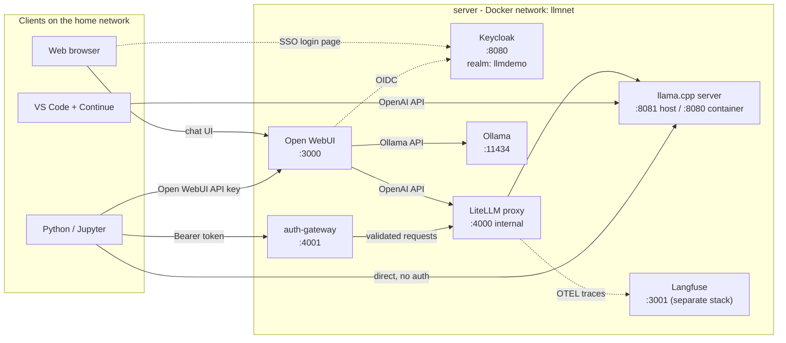

# llm-openai-stack

A self-hosted, OpenAI-compatible LLM stack running in Docker on a server on the home network.
It gives you:

- A **ChatGPT-style web UI** (Open WebUI) with **single sign-on** through Keycloak
- An **OpenAI-compatible API** you can call from Python, notebooks, or any OpenAI SDK
- A **local coding assistant** in VS Code (via the Continue extension)

Everything runs locally — no data leaves your network.

| Item | Value |
|---|---|
| Host | server (`ssh <your-server>`), LAN IP `<SERVER_IP>` |
| Code location | `~/llm-openai-stack` |
| Default coding model | `bartowski/Qwen2.5-Coder-3B-Instruct-GGUF:Q4_K_M` (llama.cpp) |
| General model | `llama3.2:3b` (Ollama) |

> **Placeholders used in this README:** replace `<SERVER_IP>` with the LAN IP of the
> machine running the stack (examples use it for access from other devices on the
> network); on the host itself you can use `localhost`. Replace `<your-server>` with your
> SSH host/alias. Nothing here is specific to a particular machine.

---

## Table of contents

1. [Architecture](#1-architecture)
2. [Modules](#2-modules)
3. [Running the stack](#3-running-the-stack)
4. [Using it from the web](#4-using-it-from-the-web)
5. [Using it from VS Code](#5-using-it-from-vs-code)
6. [Authentication and users](#6-authentication-and-users)
7. [API access and API tokens](#7-api-access-and-api-tokens)
8. [Python / Jupyter notebook examples](#8-python--jupyter-notebook-examples)
9. [Observability with Langfuse](#9-observability-with-langfuse)
10. [Changing the model](#10-changing-the-model)
11. [Troubleshooting](#11-troubleshooting)

---

## 1. Architecture



**Request flow, in words:**

- **Web chat:** Browser → Open WebUI → (login via Keycloak) → LiteLLM → llama.cpp *or* Open WebUI → Ollama.
- **VS Code:** Continue → llama.cpp directly on port `8081`.
- **Programmatic API:** Python → Open WebUI API (API key), or → auth-gateway (bearer token) → LiteLLM → llama.cpp, or → llama.cpp directly on the LAN.
- **Observability:** every request that passes through **LiteLLM** is exported as a trace to **Langfuse** (OpenTelemetry). Calls that bypass LiteLLM (direct llama.cpp on `:8081`, direct Ollama on `:11434`) are **not** traced — see §9.

---

## 2. Modules

| Service | Image | Host port | Purpose |
|---|---|---|---|
| `open-webui` | `ghcr.io/open-webui/open-webui:main` | `3000` → 8080 | Web chat UI, user accounts, chat history, per-user API keys |
| `keycloak` | `quay.io/keycloak/keycloak:26.0` | `8080` | Identity provider (OIDC). Realm `llmdemo`, client `open-webui` |
| `auth-gateway` | built locally (`./auth-gateway`, FastAPI/uvicorn) | `4001` | Front door for programmatic API access; requires a bearer token |
| `litellm` | `ghcr.io/berriai/litellm:main-latest` | internal `4000` | OpenAI-compatible proxy that routes model names (e.g. `qwen-coder`) to backends |
| `llamacpp` | `ghcr.io/ggml-org/llama.cpp:server` | `8081` → 8080 | Runs the GGUF coding model, OpenAI-compatible `/v1` API |
| `ollama` | `ollama/ollama:latest` | `11434` | Second model runtime; easy `ollama pull` model management |
| `portainer` *(optional, separate)* | `portainer/portainer-ce` | `9443` | Docker management UI at `https://<SERVER_IP>:9443` |
| `langfuse` *(separate stack)* | `langfuse/langfuse` | `3001` | LLM observability — traces, latency, token counts, cost. Receives OTEL traces from LiteLLM. Dashboard at `http://<SERVER_IP>:3001` |

### open-webui
The main user interface. Users log in with **Continue with Keycloak**. Open WebUI talks to LiteLLM (OpenAI-style connection) and to Ollama. It can also issue **personal API keys** (see §7).

Key environment variables:

| Variable | Meaning |
|---|---|
| `OPENID_PROVIDER_URL` | Keycloak discovery URL (`http://keycloak:8080/realms/llmdemo/.well-known/openid-configuration`) |
| `OAUTH_CLIENT_ID` / `OAUTH_CLIENT_SECRET` | Keycloak client credentials (keep the secret in `.env`) |
| `OPENID_REDIRECT_URI` | Where Keycloak sends the browser after login |
| `ENABLE_OAUTH_SIGNUP` | Auto-create an Open WebUI account on first SSO login |
| `OAUTH_PROVIDER_NAME` | Button label ("Keycloak") |

### keycloak
Holds user accounts. Admin console: `http://<SERVER_IP>:8080` (realm `master`, bootstrap admin from `KC_BOOTSTRAP_ADMIN_USERNAME` / `KC_BOOTSTRAP_ADMIN_PASSWORD`). Application users live in the **`llmdemo`** realm.

### auth-gateway
Small FastAPI service exposed on `4001`. Requests without `Authorization: Bearer <token>` get `401 missing bearer token`. It forwards authorized requests to LiteLLM. See `auth-gateway/` for exactly how tokens are validated.

### litellm
Maps friendly model names to backends. Its config file defines entries like:

```yaml
model_list:
  - model_name: qwen-coder
    litellm_params:
      model: openai/qwen-coder
      api_base: http://llamacpp:8080/v1
      api_key: none
```

### llamacpp
Configured in `docker-compose.override.yml`:

```yaml
command:
  - -hf
  - bartowski/Qwen2.5-Coder-3B-Instruct-GGUF:Q4_K_M   # model (Hugging Face repo:quant)
  - --host
  - 0.0.0.0
  - --port
  - '8080'
  - -c
  - '16384'      # total context, shared across slots
  - --parallel
  - '2'          # 2 concurrent requests -> 8192 tokens each
  - -t
  - '4'          # CPU threads
  - --jinja      # chat templates + tool calling
ports:
  - "8081:8080"
```

Models download into the `llamacpp-models` volume on first start.

### ollama
Holds `llama3.2:3b`. Manage models with `ollama pull / list / rm` inside the container.

---

## 3. Running the stack

```bash
ssh <your-server>
cd ~/llm-openai-stack

cp .env.example .env        # first time only; fill in secrets
sudo docker compose up -d   # start everything
sudo docker compose ps      # check status
sudo docker compose logs -f llamacpp   # follow one service's logs
```

Stop / restart:

```bash
sudo docker compose down                 # stop all (volumes are kept)
sudo docker compose restart open-webui   # restart one service
sudo docker compose up -d llamacpp       # re-create one service after editing its config
```

> `docker-compose.override.yml` is picked up automatically together with `docker-compose.yml`.

---

## 4. Using it from the web

| Where you are | URL |
|---|---|
| On the server | `http://localhost:3000` |
| Another device on the LAN | `http://<SERVER_IP>:3000` |

1. Click **Continue with Keycloak**.
2. Sign in with your Keycloak user from the `llmdemo` realm.
3. Pick a model from the dropdown (`qwen-coder`, `llama3.2`) and chat.

### Logging in from another device (laptop)

The current config uses Docker-internal names (`keycloak:8080`) and a `localhost:3000` redirect, so SSO from another machine needs one of these:

**Option A — SSH tunnel (no server changes):**

```bash
# on the laptop, once:
echo "127.0.0.1   keycloak" | sudo tee -a /etc/hosts

# each session (leave running):
ssh -L 3000:localhost:3000 -L 8080:localhost:8080 <your-server>
```

Then open `http://localhost:3000`.

**Option B — make it work on the LAN permanently:**

1. On each client, add `<SERVER_IP>   keycloak` to `/etc/hosts`.
2. Set `OPENID_REDIRECT_URI=http://<SERVER_IP>:3000/oauth/oidc/callback` for Open WebUI.
3. In Keycloak → `llmdemo` → Clients → `open-webui`, add `http://<SERVER_IP>:3000/*` to **Valid redirect URIs**.
4. `sudo docker compose up -d open-webui`

---

## 5. Using it from VS Code

1. Install the **Continue** extension (Extensions → search "Continue").
2. Open Continue → gear icon → edit `~/.continue/config.yaml`:

```yaml
name: server
version: 0.0.1
schema: v1
models:
  - name: Qwen2.5-Coder 3B (server)
    provider: openai
    model: bartowski/Qwen2.5-Coder-3B-Instruct-GGUF:Q4_K_M
    apiBase: http://<SERVER_IP>:8081/v1
    apiKey: none
    defaultCompletionOptions:
      contextLength: 8192
    roles: [chat, edit, apply, autocomplete]
```

3. Use it:
   - **Chat** — type in the Continue panel
   - **Edit** — select code, `Cmd+I`, describe the change
   - **Autocomplete** — grey inline suggestions, `Tab` to accept

**Tips**
- Use **Chat** mode rather than **Agent** mode with the 3B model — small models are unreliable at the structured tool calls Agent mode needs.
- `contextLength` must not exceed the per-slot context (`-c` ÷ `--parallel`).
- If you add `--api-key` to llama.cpp (see §7), put the same value in `apiKey`.

Quick connectivity check from the laptop:

```bash
curl http://<SERVER_IP>:8081/v1/models
```

---

## 6. Authentication and users

There are **two layers** of identity:

| Layer | Where | Used for |
|---|---|---|
| Keycloak users (realm `llmdemo`) | `http://<SERVER_IP>:8080` | Logging in to Open WebUI via SSO |
| Open WebUI accounts + roles | Open WebUI → Admin Panel → Users | Permissions (admin / user / pending), API keys |

On first SSO login, Open WebUI auto-creates a matching account (`ENABLE_OAUTH_SIGNUP=true`). The first account ever created is the Open WebUI **admin**; later accounts may land in **pending** until an admin approves them.

### Create a user (Admin console)

1. `http://<SERVER_IP>:8080` → **Administration Console** → log in as the bootstrap admin.
2. Switch realm to **llmdemo**.
3. **Users → Create new user** — set username, **email** (required by Open WebUI), turn on **Email verified**.
4. **Credentials → Set password**, turn **Temporary** off.

### Create / manage users (CLI)

```bash
cd ~/llm-openai-stack && source .env   # provides KEYCLOAK_ADMIN / KEYCLOAK_ADMIN_PASSWORD
KC="sudo docker exec llm-openai-stack-keycloak-1 /opt/keycloak/bin/kcadm.sh"

# authenticate the CLI (once per container restart)
$KC config credentials --server http://localhost:8080 --realm master \
    --user "$KEYCLOAK_ADMIN" --password "$KEYCLOAK_ADMIN_PASSWORD"

# list users
$KC get users -r llmdemo --fields username,email

# create a user
$KC create users -r llmdemo -s username=alice -s email=alice@home.local \
    -s emailVerified=true -s enabled=true

# set / reset a password
$KC set-password -r llmdemo --username alice --new-password 'S0me-Strong-Pass'
```

### Passwords: the realm file vs. the running Keycloak (important)

Keycloak imports `keycloak/realm-export.json` (rendered from `.env` by `setup.sh`) **only
when it creates its database** — on first start, and again whenever the `keycloak`
container is **recreated**. This dev setup runs Keycloak with `start-dev` and **no
persistent volume**, so `docker compose down` + `up` (or `--force-recreate`) wipes its
users and re-imports the realm from the file.

What this means in practice:

- **Editing `.env` or the realm file does _not_ change existing users** on a running
  container — it takes effect only on the next recreate/re-import.
- **`kcadm set-password` changes the live Keycloak immediately** and survives
  `docker compose restart`, but is **lost on recreate** (the user reverts to the
  realm-file password).

So if the `demo` login fails **even with the `DEMO_USER_PASSWORD` from `.env`**, the
running container was imported from an older realm. Two ways to fix it:

**A — set the password now (no downtime, no data loss):**

```bash
source .env
KC="sudo docker exec llm-openai-stack-keycloak-1 /opt/keycloak/bin/kcadm.sh"
$KC config credentials --server http://localhost:8080 --realm master \
    --user "$KEYCLOAK_ADMIN" --password "$KEYCLOAK_ADMIN_PASSWORD"
$KC set-password -r llmdemo --username demo --new-password 'Demo12345!'
```

**B — re-sync Keycloak to `.env` (⚠️ wipes any Keycloak users/roles you added by hand):**

```bash
./setup.sh                                           # re-render realm from .env
sudo docker compose up -d --force-recreate keycloak  # recreate -> re-import realm
```

After B, `demo`'s password is whatever `DEMO_USER_PASSWORD` is in `.env`.

> Want Keycloak users to survive recreates? Give it a real database and a named volume
> (switch `start-dev` → `start` with a Postgres service). Out of scope for this dev
> setup — that's the trade-off for the zero-config realm import.

### Approve a pending user / make someone admin
Open WebUI → profile menu → **Admin Panel → Users** → change role to **user** or **admin**.

---

## 7. API access and API tokens

There are three ways to call the models programmatically:

| Endpoint | Base URL | Auth | Best for |
|---|---|---|---|
| **Open WebUI API** | `http://<SERVER_IP>:3000/api` | Personal API key (`sk-...`) | Per-user access with all Open WebUI models |
| **auth-gateway** | `http://<SERVER_IP>:4001/v1` | Bearer token — static `GATEWAY_SERVICE_TOKEN`, or a Keycloak OAuth token | Controlled access to LiteLLM models (`qwen-coder`); traced in Langfuse |
| **llama.cpp direct** | `http://<SERVER_IP>:8081/v1` | None (or `--api-key`) | VS Code, quick local scripts |

All three speak the **OpenAI API format**, so any OpenAI client works.

### 7.1 Generate an Open WebUI API key (recommended)

The key is created inside the Open WebUI app (not in `.env` or Keycloak), and each user
makes their own. **This trips everyone up:** enabling API keys and creating a key happen
in **two different "Settings" screens** — the admin one and your personal one. You must do
both. (Paths below are for Open WebUI **v0.12**; earlier versions differ slightly.)

**Step 1 — enable API keys (admin, once).** Avatar (bottom-left) → **Admin Panel** →
**Settings** → **Authentication** → turn on **Enable API Key** → **Save**. (On some builds
this toggle is under **General** instead of **Authentication** — it's one of those two.)

**Step 2 — create your key (personal settings).** Avatar (bottom-left) → **Settings** —
the *personal* Settings, **not** Admin Panel — → **Account** tab → scroll to the
**API Keys** section → **Create new secret key**. Copy the `sk-...` value (shown once).

> If the **API Keys** section doesn't appear under **Account** even after Step 1, hard-refresh
> the page (**Ctrl+Shift+R**) so the newly-enabled setting loads, or sign out and back in.

```bash
export OPENWEBUI_API_KEY="sk-..."
```

Test it (a `200` with JSON = working; `401` = key missing/empty or the Enable-API-Key
toggle; you will **not** get a `404` from `/api/models` — a bare `/api` 404s because it's
a base URL, not a page):

```bash
curl -H "Authorization: Bearer $OPENWEBUI_API_KEY" \
     http://<SERVER_IP>:3000/api/models

curl -X POST http://<SERVER_IP>:3000/api/chat/completions \
  -H "Authorization: Bearer $OPENWEBUI_API_KEY" \
  -H "Content-Type: application/json" \
  -d '{"model": "qwen-coder", "messages": [{"role": "user", "content": "Say hello"}]}'
```

Revoke a key by deleting it on the same API Keys page.

### 7.2 auth-gateway bearer token

The gateway on port `4001` is an OAuth 2.0 resource server. Every `/v1/...` request
must carry `Authorization: Bearer <token>`, and the gateway (`auth-gateway/main.py`)
accepts **two kinds** of token:

1. **A static service token** — the value of `GATEWAY_SERVICE_TOKEN` from `.env`.
   Accepted as-is, no Keycloak round-trip. Simplest for scripts on the trusted LAN.
2. **A Keycloak access token (JWT)** — validated on every request against four things:

   | Check | Must be | Why it matters |
   |---|---|---|
   | Signature | signed by Keycloak (RS256, via JWKS) | genuine token |
   | `aud` | contains `llm-api` | minted for *this* API (the audience mapper adds it) |
   | `iss` | `http://keycloak:8080/realms/llmdemo` | **must match `JWT_ISSUER`** (= your `PUBLIC_KEYCLOAK_URL` + `/realms/llmdemo`) |
   | realm role | includes `llm_user` | caller is authorized |

   A token failing signature/`aud`/`iss`/`exp` gets **401**; a valid token without the
   `llm_user` role gets **403**.

#### Option A — static service token (quickest)

```bash
# the token is already in your .env on the server
cd ~/llm-openai-stack && source .env

curl -H "Authorization: Bearer $GATEWAY_SERVICE_TOKEN" \
     http://<SERVER_IP>:4001/v1/models
```

This is a **shared** secret — every caller using it looks identical to the gateway
(and to Langfuse). Use it for your own scripts; use Option B when you need a real
per-identity token.

#### Option B — Keycloak OAuth token

Use the **`llm-cli`** client (it has *Direct access grants* and *Service accounts*
enabled and carries the `llm-api` audience). The `open-webui` client will **not** work
here — direct grants are disabled on it.

> **Critical:** request the token from the **`keycloak:8080`** host, *not* the
> `<SERVER_IP>` IP. Keycloak stamps `iss` from the host you call, and the gateway
> rejects any `iss` that isn't `http://keycloak:8080/realms/llmdemo`. On the server
> this works because `127.0.0.1  keycloak` is in `/etc/hosts` (§4); from another machine,
> point `keycloak` at `<SERVER_IP>` in its `/etc/hosts` first.

**Service-to-service** (no user — uses the `llm-cli` service account, which holds the
`llm_user` role):

```bash
cd ~/llm-openai-stack && source .env   # provides LLMCLI_CLIENT_SECRET

TOKEN=$(curl -s \
  http://keycloak:8080/realms/llmdemo/protocol/openid-connect/token \
  -d grant_type=client_credentials \
  -d client_id=llm-cli \
  -d client_secret="$LLMCLI_CLIENT_SECRET" | jq -r .access_token)

curl -H "Authorization: Bearer $TOKEN" http://<SERVER_IP>:4001/v1/models
```

**On behalf of a specific user** (password grant — the user must have the `llm_user`
role; the bundled `demo` user does):

```bash
TOKEN=$(curl -s \
  http://keycloak:8080/realms/llmdemo/protocol/openid-connect/token \
  -d grant_type=password \
  -d client_id=llm-cli \
  -d client_secret="$LLMCLI_CLIENT_SECRET" \
  -d username=demo \
  -d password="$DEMO_USER_PASSWORD" | jq -r .access_token)

curl -H "Authorization: Bearer $TOKEN" http://<SERVER_IP>:4001/v1/models
```

Inspect what you got (handy when debugging a 401/403) — decode the payload:

```bash
echo "$TOKEN" | cut -d. -f2 | base64 -d 2>/dev/null | jq '{iss, aud, realm_access}'
# expect: iss "http://keycloak:8080/realms/llmdemo", aud includes "llm-api",
#         realm_access.roles includes "llm_user"
```

Access tokens expire after a few minutes (realm setting **Access Token Lifespan**);
scripts should fetch a fresh one as needed. The password grant is deprecated in OAuth
2.1 — prefer client-credentials for automation, and the browser SSO flow for real users.

### 7.3 Protect the direct llama.cpp endpoint (optional)

Add to the `llamacpp` command in `docker-compose.override.yml`:

```yaml
    - --api-key
    - 'your-secret'
```

then `sudo docker compose up -d llamacpp`. Clients must now send `Authorization: Bearer your-secret`. Update the LiteLLM entry (`api_key: your-secret`) and the Continue config to match.

---

## 8. Python / Jupyter notebook examples

```bash
pip install openai requests
```

### 8.1 Via Open WebUI API key

```python
import os
from openai import OpenAI

client = OpenAI(
    base_url="http://<SERVER_IP>:3000/api",
    api_key=os.environ["OPENWEBUI_API_KEY"],
)

print([m.id for m in client.models.list().data])

resp = client.chat.completions.create(
    model="qwen-coder",
    messages=[
        {"role": "system", "content": "You are a concise coding assistant."},
        {"role": "user", "content": "Write a Python function that checks if a number is prime."},
    ],
)
print(resp.choices[0].message.content)
```

### 8.2 Direct to llama.cpp (LAN, no key)

```python
from openai import OpenAI

client = OpenAI(base_url="http://<SERVER_IP>:8081/v1", api_key="none")

resp = client.chat.completions.create(
    model="bartowski/Qwen2.5-Coder-3B-Instruct-GGUF:Q4_K_M",
    messages=[{"role": "user", "content": "Explain list comprehensions in one paragraph."}],
    temperature=0.2,
    max_tokens=400,
)
print(resp.choices[0].message.content)
```

### 8.3 Streaming tokens as they arrive

```python
stream = client.chat.completions.create(
    model="bartowski/Qwen2.5-Coder-3B-Instruct-GGUF:Q4_K_M",
    messages=[{"role": "user", "content": "Write a haiku-free limerick about Docker."}],
    stream=True,
)
for chunk in stream:
    delta = chunk.choices[0].delta.content
    if delta:
        print(delta, end="", flush=True)
```

### 8.4 Through the auth-gateway

Two ways to get the bearer token the gateway wants (see §7.2). Simplest is the static
service token:

```python
import os
from openai import OpenAI

# GATEWAY_SERVICE_TOKEN comes from .env (export it, or load the .env first)
client = OpenAI(base_url="http://<SERVER_IP>:4001/v1",
                api_key=os.environ["GATEWAY_SERVICE_TOKEN"])
resp = client.chat.completions.create(
    model="qwen-coder",
    messages=[{"role": "user", "content": "Hello from the gateway"}],
)
print(resp.choices[0].message.content)
```

Or mint a per-identity Keycloak token with the `llm-cli` client. Note the token endpoint
uses the **`keycloak`** host (so `iss` matches what the gateway expects — §7.2), while the
API call uses the LAN IP:

```python
import os, requests
from openai import OpenAI

def get_keycloak_token():
    r = requests.post(
        "http://keycloak:8080/realms/llmdemo/protocol/openid-connect/token",
        data={
            "grant_type": "client_credentials",          # service-to-service
            "client_id": "llm-cli",
            "client_secret": os.environ["LLMCLI_CLIENT_SECRET"],
        },
        timeout=10,
    )
    r.raise_for_status()
    return r.json()["access_token"]

client = OpenAI(base_url="http://<SERVER_IP>:4001/v1", api_key=get_keycloak_token())
resp = client.chat.completions.create(
    model="qwen-coder",
    messages=[{"role": "user", "content": "Hello from the gateway"}],
)
print(resp.choices[0].message.content)
```

### 8.5 Ollama model (llama3.2)

```python
from openai import OpenAI

ollama = OpenAI(base_url="http://<SERVER_IP>:11434/v1", api_key="ollama")
resp = ollama.chat.completions.create(
    model="llama3.2:3b",
    messages=[{"role": "user", "content": "Give me three fun facts about octopuses."}],
)
print(resp.choices[0].message.content)
```

> Keep secrets out of notebooks: read them from environment variables or a local `.env` file (which is git-ignored).

---

## 9. Observability with Langfuse

[Langfuse](https://langfuse.com) gives you traces, latency, token counts, and cost
for every model call. In this stack the integration lives at the **LiteLLM** layer:
LiteLLM is configured to export each request it handles to Langfuse over
**OpenTelemetry (OTEL v2)**. You don't instrument any client code — point your calls
at LiteLLM (through the web UI or the auth-gateway) and they show up in Langfuse.

Langfuse itself runs as a **separate stack** (its own `docker-compose`, with Postgres
and ClickHouse), not inside this one. Here it lives on `http://<SERVER_IP>:3001`.

### 9.1 What is and isn't traced

The rule is simple: **anything that reaches LiteLLM is traced; direct-to-backend calls are not.**

| Path | Through LiteLLM? | Traced in Langfuse? |
|---|---|---|
| Web chat (Open WebUI → auth-gateway → LiteLLM) | yes | ✅ |
| Open WebUI personal API key → `:3000/api` (models served via LiteLLM) | yes | ✅ |
| auth-gateway bearer token → `:4001/v1` | yes | ✅ |
| VS Code / Continue → llama.cpp `:8081` | no | ❌ |
| Python direct → llama.cpp `:8081` or Ollama `:11434` | no | ❌ |

If you want a call traced, route it through the gateway (`:4001`) or the web UI rather
than hitting a backend port directly.

### 9.2 How it's wired

**`litellm/config.yaml`** registers the callback:

```yaml
litellm_settings:
  drop_params: true
  callbacks: ["langfuse_otel"]   # export every request to Langfuse over OTEL
```

**`docker-compose.yml`** (the `litellm` service) supplies the exporter config:

```yaml
    environment:
      LITELLM_MASTER_KEY: ${LITELLM_MASTER_KEY}
      LITELLM_OTEL_V2: "true"                       # use the OTEL v2 pipeline
      LANGFUSE_PUBLIC_KEY: ${LANGFUSE_PUBLIC_KEY}
      LANGFUSE_SECRET_KEY: ${LANGFUSE_SECRET_KEY}
      LANGFUSE_HOST: http://<SERVER_IP>:3001      # where Langfuse is reachable
```

LiteLLM posts OTLP spans to `${LANGFUSE_HOST}/api/public/otel`, authenticating with the
public/secret key pair. `LANGFUSE_HOST` uses the server's **LAN IP** rather than a
Docker service name because Langfuse runs in a different compose project (a different
Docker network), so the `litellm` container reaches it via the host. If you later move
Langfuse onto the `llmnet` network, switch this to its service name instead.

### 9.3 Setup / keys

The keys come from your Langfuse project, not from Keycloak:

1. Open Langfuse at `http://<SERVER_IP>:3001` and sign in.
2. **Settings → API Keys → Create new API keys** for the project.
3. Put the pair in `.env` on the server (git-ignored):

   ```bash
   LANGFUSE_PUBLIC_KEY=pk-lf-...
   LANGFUSE_SECRET_KEY=sk-lf-...
   ```

   > These two keys are referenced by `docker-compose.yml` but are **not** yet in
   > `.env.example` — add them there (with placeholder values) so the integration is
   > reproducible on a fresh checkout.

4. Recreate LiteLLM so it picks them up:

   ```bash
   sudo docker compose up -d litellm
   ```

### 9.4 Verify it's working

Send a request through a traced path, then look in Langfuse:

```bash
# through the auth-gateway (replace with a real bearer token — see §7.2)
curl -s http://<SERVER_IP>:4001/v1/chat/completions \
  -H "Authorization: Bearer $TOKEN" -H "Content-Type: application/json" \
  -d '{"model":"qwen-coder","messages":[{"role":"user","content":"trace test"}]}' >/dev/null
```

Then open `http://<SERVER_IP>:3001` → **Tracing → Traces**; the call should appear
within a few seconds, showing the model name (`qwen-coder` / `llama3.2`), latency, and
token usage. If nothing shows up, check the exporter logs:

```bash
sudo docker compose logs --tail 50 litellm | grep -i -E "langfuse|otel"
```

### 9.5 Per-user attribution (note)

Web-chat traffic reaches LiteLLM as the **single shared** `GATEWAY_SERVICE_TOKEN`, so
in Langfuse all browser requests look like one caller. To attribute traces to individual
end users, enable per-user OAuth-token forwarding in Open WebUI so each user's identity
flows through to LiteLLM. API calls made with their own gateway bearer token are already
distinguishable.

---

## 10. Changing the model

### 10.1 llama.cpp model (coding model)

1. Pick a GGUF on Hugging Face, e.g. `bartowski/Qwen2.5-Coder-7B-Instruct-GGUF`, and a quantization (`Q4_K_M` is a good default).
2. Edit `docker-compose.override.yml`:

   ```yaml
   command:
     - -hf
     - bartowski/Qwen2.5-Coder-7B-Instruct-GGUF:Q4_K_M
   ```

3. Apply (downloads the model on first start — watch the logs):

   ```bash
   sudo docker compose up -d llamacpp
   sudo docker compose logs -f llamacpp
   curl http://localhost:8081/v1/models
   ```

4. Update clients that reference the model id:
   - **Continue** → `model:` in `~/.continue/config.yaml`
   - **Python** → `model=` in direct-to-llama.cpp examples
   - **LiteLLM** → only if you change the friendly name; `qwen-coder` can keep pointing at whatever llama.cpp serves.

**Sizing on this server (CPU only):** 1.5B–3B models are responsive; 7B works but is noticeably slower. Lower `-c` or `--parallel` if memory is tight (`free -h`).

### 10.2 Ollama models

```bash
sudo docker exec llm-openai-stack-ollama-1 ollama pull qwen2.5-coder:7b
sudo docker exec llm-openai-stack-ollama-1 ollama list
sudo docker exec llm-openai-stack-ollama-1 ollama rm llama3.2:3b
```

New Ollama models appear in the Open WebUI model dropdown automatically.

### 10.3 Adding a model name in LiteLLM

Add an entry to the LiteLLM config's `model_list`, then `sudo docker compose restart litellm`.

---

## 11. Troubleshooting

| Symptom | Fix |
|---|---|
| "keycloak can't be reached" after clicking SSO | Add a `keycloak` entry to `/etc/hosts` on the client (§4) |
| Redirected to `localhost:3000` and it fails | Use the SSH tunnel, or set `OPENID_REDIRECT_URI` to the LAN IP (§4) |
| Keycloak: "Invalid username or password" | User must exist in realm **llmdemo**, not `master`; reset with `kcadm.sh set-password` |
| `demo` login fails **even with the `.env` password** | The running Keycloak was imported from an older realm (no persistent volume). Reset the password with `kcadm set-password`, or `--force-recreate keycloak` to re-import `.env` — see §6 "Passwords: the realm file vs. the running Keycloak" |
| Open WebUI: "Account Activation Pending" | An admin approves the user in Admin Panel → Users |
| `401 missing bearer token` on `:4001` | Send `Authorization: Bearer <token>` (§7.2) |
| `401 invalid token` on `:4001` with a real Keycloak token | Almost always an `iss` mismatch: you requested the token from `<SERVER_IP>:8080` instead of `keycloak:8080`. Re-request from the `keycloak` host (§7.2). Also check the token hasn't expired. |
| `403 token missing required role 'llm_user'` on `:4001` | The user/service account lacks the `llm_user` realm role — add it in Keycloak (realm `llmdemo`) |
| `invalid_client` / `unauthorized_client` from the token endpoint | Use client `llm-cli` (not `open-webui`) for direct/client-credentials grants, with `LLMCLI_CLIENT_SECRET` (§7.2) |
| VS Code: Agent mode tool calls fail | Use Chat mode, or a larger model |
| Slow responses | Expected on CPU; use a smaller model or quant, or reduce `--parallel` |
| No traces in Langfuse | Confirm the call goes **through LiteLLM** (direct `:8081`/`:11434` calls aren't traced — §9.1); check `LANGFUSE_PUBLIC_KEY`/`LANGFUSE_SECRET_KEY` are set in `.env`; check `http://<SERVER_IP>:3001` is reachable from the `litellm` container; `sudo docker compose logs litellm | grep -i -E "langfuse\|otel"` |
| Langfuse traces missing token/cost | Normal for some local backends; counts depend on usage data returned by the model server |
| Check a service | `sudo docker compose logs --tail 50 <service>` |

---

## Security notes

- All secrets (`OPENWEBUI_CLIENT_SECRET`, `LLMCLI_CLIENT_SECRET`, `KEYCLOAK_ADMIN_PASSWORD`, `GATEWAY_SERVICE_TOKEN`, `LITELLM_MASTER_KEY`, `LANGFUSE_*`, API keys) belong in `.env`, which is git-ignored. Commit a `.env.example` with placeholder values instead.
- Ports `8081` (llama.cpp) and `11434` (Ollama) have no authentication — anyone on the LAN can use them. Add `--api-key` to llama.cpp if that matters.
- Don't expose these ports to the internet without TLS and authentication in front.
